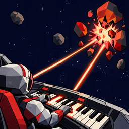

  

# Soporte de AstroShredder

AstroShredder es un juego de naves que se juega con un piano. Los enemigos vuelan hacia tu nave cargando notas musicales. Tócalas en tu teclado para destruirlos.

[English](../) · [Política de privacidad](privacy)

## Contacto

¿Preguntas, errores o comentarios? Escribe a **[manolofdez@gmail.com](mailto:manolofdez@gmail.com)** e incluye el modelo de tu dispositivo y, si usas uno, el modelo de tu teclado MIDI.

## Preguntas frecuentes

### ¿Necesito un piano para jugar?

No. AstroShredder incluye un piano virtual en pantalla, con un botón de pedal de sostenido para tocar acordes. Aunque con un teclado MIDI es mucho más divertido.

### ¿Cómo conecto mi teclado MIDI?

- **USB:** conecta tu teclado a tu iPhone o iPad con un cable (puede que necesites un adaptador USB-C o Lightning). Debería aparecer de inmediato en **Ajustes → MIDI**.
- **Bluetooth:** activa el MIDI por Bluetooth en tu teclado, luego abre **Ajustes → MIDI** en AstroShredder y selecciónalo en **Otros dispositivos Bluetooth**.

### ¿Cómo pauso el juego?

Toca cualquier parte de la pantalla de juego por encima del piano. Desde la pantalla de pausa puedes **Continuar**, **Reiniciar** el nivel o **Salir**. El juego también se pausa automáticamente si sales de la app.

### Mi teclado Bluetooth no aparece

- Asegúrate de que el teclado esté encendido, visible y cerca.
- Asegúrate de que el Bluetooth esté activado y de que AstroShredder tenga acceso a Bluetooth en la app Ajustes de iOS.
- Prueba **Empareja con el selector Bluetooth de Apple** al final de **Ajustes → MIDI**.
- Algunos teclados necesitan que actives el MIDI por Bluetooth en sus propios ajustes o en su app. Consulta el manual de tu teclado.

### El juego es muy difícil o muy fácil

Cambia la dificultad cuando quieras en **Ajustes → General → Dificultad**. Para practicar algo en concreto, usa **Práctica** desde el menú principal y elige la tonalidad, la escala, los acordes, los enemigos, la velocidad y la densidad.

### ¿Puedo cambiar los colores de las teclas?

Sí. Ve a **Ajustes → Visual → Colores** y presiona una tecla para cambiar el color de esa nota.

### ¿Cómo empiezo de cero?

Usa **Ajustes → General → Reiniciar** para borrar tu progreso y los tutoriales.
