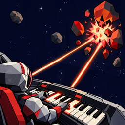

  

# AstroShredder Support

AstroShredder is a space shooter you play with a piano. Enemies fly at your ship carrying musical notes. Play them on your keyboard to blast them away.

[Español](es/) · [Privacy Policy](privacy)

## Contact

Questions, bug reports or feedback? Email **YOUR-EMAIL** and include your device model and, if you use one, the model of your MIDI keyboard.

## FAQ

### Do I need a piano to play?

No. AstroShredder includes an on-screen virtual piano, with a sustain pedal button for playing chords. A MIDI keyboard makes it a lot more fun, though.

### How do I connect my MIDI keyboard?

- **USB:** connect your keyboard to your iPhone or iPad with a cable (you may need a USB-C or Lightning adapter). It should appear right away under **Settings → MIDI**.
- **Bluetooth:** turn on Bluetooth MIDI on your keyboard, then open **Settings → MIDI** in AstroShredder and select it under **Other Bluetooth Devices**.

### My Bluetooth keyboard doesn't show up

- Make sure the keyboard is powered on, discoverable and nearby.
- Make sure Bluetooth is turned on and that AstroShredder has Bluetooth access in the iOS Settings app.
- Try **Pair with Apple's Bluetooth picker** at the bottom of **Settings → MIDI**.
- Some keyboards need Bluetooth MIDI turned on in their own settings or companion app. Check your keyboard's manual.

### The game is too hard or too easy

Change the difficulty any time in **Settings → Game → Difficulty**. For focused practice, use **Practice** from the main menu to pick the key, scale, chords, enemies, speed and density.

### Can I change the key colors?

Yes. Go to **Settings → Display → Palette** and press a key to change that note's color.

### How do I start over?

Use **Settings → Game → Reset** to clear your progress and tutorials.
